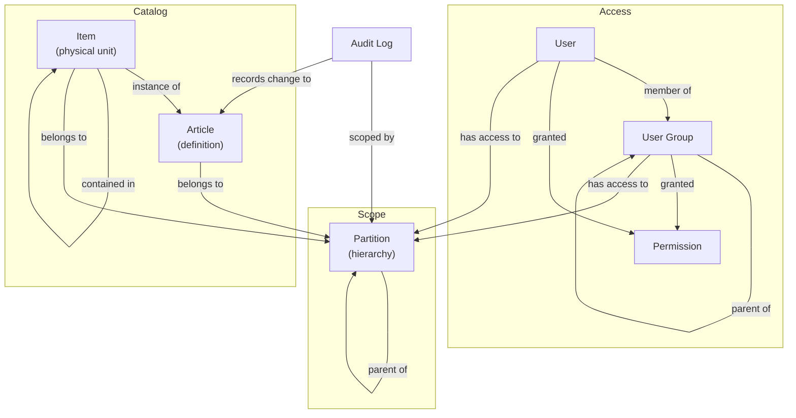

# Concepts

This section explains the ideas Fargo is built on, in plain terms, independent
of any API or code. If you want to understand *what the system models and how it
behaves* — what a user is, how permissions and partitions decide who can do and
see what, how items live inside containers, and how audit logs are scoped — start
here.

For implementation detail (types, interfaces, database schema), see the
[Server](~/docs/server/overview.md) section and the
[.NET API Reference](~/api/index.md).

## The mental model

Fargo manages the physical contents of a warehouse or stockroom and controls who
may see and change them. Three ideas carry most of the weight:

1. **What exists** — the catalog of product definitions (**articles**) and the
   physical units of those definitions (**items**).
2. **Who can act** — accounts (**users**) and the groups they belong to
   (**user groups**), each carrying **permissions**.
3. **Who can see what** — a hierarchy of **partitions** that scopes every piece
   of data to a slice of the organization.

Every change is written to an **audit log** so the history of the system is
always recoverable and attributable.

## How the pieces fit together

The key separation to keep in mind:

- **Permissions answer "what *actions* may I perform?"** — for example, "create
  items" or "delete articles."
- **Partitions answer "which *data* may I act on?"** — for example, "the
  Warehouse A branch and everything under it."

An operation is allowed only when **both** are satisfied: the actor must hold the
permission for the action *and* have partition access to the data it touches.

## Read next

- [Articles and Items](articles-and-items.md) — the catalog and the physical
  things on the shelves.
- [Partitions](partitions.md) — the hierarchy that scopes all data and the rules
  of access inheritance.
- [Users and User Groups](users-and-groups.md) — accounts, group membership, and
  how access is composed.
- [Permissions](permissions.md) — the actions an actor may perform and how
  direct and inherited grants combine.
- [Audit Logs](audit-logs.md) — what is recorded and how audit visibility
  follows partitions.
