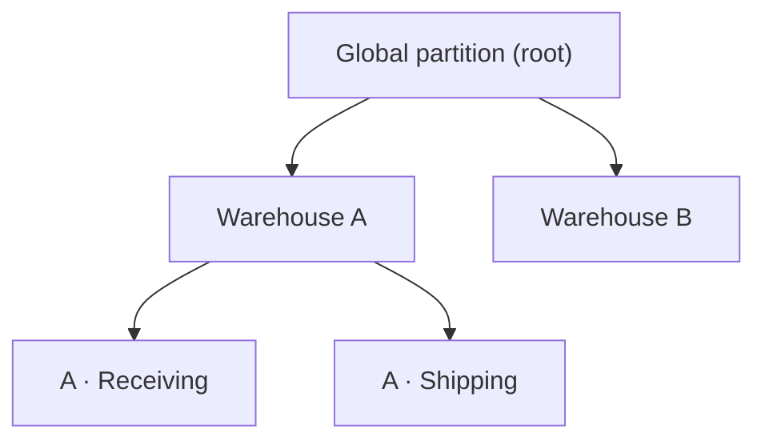

# Partitions

A **partition** is a node in a hierarchy that scopes data. Every article, item,
and audit log belongs to one or more partitions, and users and user groups are
granted *access* to partitions. Partitions are how Fargo answers the question
**"which data may this actor see and act on?"**

Think of partitions as the organizational boundaries of your data — regions,
branches, departments, teams — arranged as a tree.

## The hierarchy

Partitions form a tree with a single **global partition** at the root. The
global partition is special: it has no parent and always exists. Every other
partition has exactly one parent, so the partitions form branches beneath the
global root.

Local rules the system always enforces:

- The global partition cannot have a parent.
- A partition cannot be its own parent.
- A partition cannot be moved under one of its own descendants (no cycles).

## Access inheritance

This is the rule that governs everything:

> **Access flows from parent to child, never from child to parent.**

If an actor has access to a partition, they can also access everything in that
partition's **descendants**. Access to a child does **not** grant access to its
parent or to sibling branches.

### Worked example

Using the tree above, suppose:

- **Alice** has access to **Warehouse A**.
- **Bob** has access to **A · Shipping** only.

Then:

| Partition | Alice can access? | Bob can access? |
| --- | --- | --- |
| Global | No | No |
| Warehouse A | Yes | No |
| A · Receiving | Yes (descendant of A) | No |
| A · Shipping | Yes (descendant of A) | Yes |
| Warehouse B | No | No |

Alice sees all of Warehouse A and everything under it. Bob is confined to
Shipping — he cannot step "up" to Warehouse A, nor "sideways" to Receiving.

Access to the **global partition** sits above everything and is therefore
reserved for highly privileged users (such as the built-in administrator).

## How a resource's access is decided

Every partitioned resource (an article, item, or audit log) carries the set of
partitions it belongs to. An actor may access the resource when:

- the resource has **no** partitions (it is public), **or**
- **any** of the resource's partitions is one the actor can access.

Because access is inherited downward, "a partition the actor can access"
includes any partition that is a descendant of one the actor was granted.

## Why this matters beyond reads

Partitions are enforced on both reads and writes:

- **Listings and lookups** never return entities outside the actor's accessible
  partitions — the filter is applied when data is fetched.
- **Create, update, and delete** operations check partition access to the
  affected entity (and to any partitions being added) before proceeding.

So a user scoped to one branch can neither view nor modify data in another.

## Relationship to permissions

Partitions and [permissions](permissions.md) are independent and **both**
required:

- A permission like "delete items" means nothing on its own — the actor must
  also have partition access to the specific item being deleted.
- Conversely, partition access to a branch does not let an actor perform actions
  they lack the permission for.

See [Users and User Groups](users-and-groups.md) for how an actor accumulates
partition access from direct grants and group membership.
