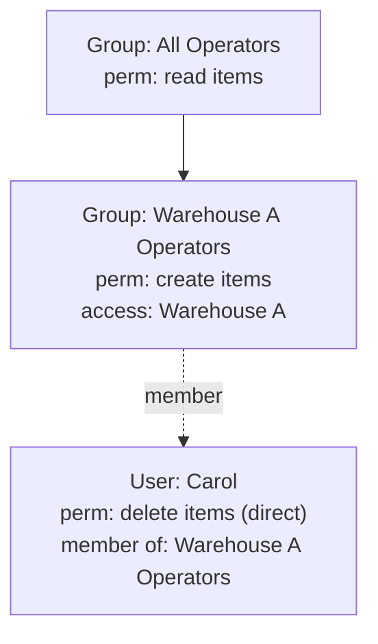

# Users and User Groups

Users and user groups are how Fargo models *who can act* and *what access they
carry*. Both can hold [permissions](permissions.md) and
[partition](partitions.md) access; users additionally belong to groups, and
groups can be nested, so access composes.

## Users

A **user** is an account that authenticates and performs actions. A user has:

- a unique **nameid** (its login identifier),
- an active/inactive state,
- optional profile fields (first name, last name, description),
- authentication details (a hashed password — never stored in plain text),
- **permissions** granted directly to it,
- **partition access** granted directly to it,
- **memberships** in one or more user groups.

An **inactive** user cannot authenticate, and access granted through inactive
accounts or groups is ignored when resolving what a user can do.

### The built-in administrator

Fargo has a well-known **administrator** user. It is always active, is a member
of the built-in administrators group, and has access to the global partition.
To keep the system always-administrable, certain operations on it are blocked —
it cannot be deactivated, cannot be removed from the administrators group, and
cannot have its global access revoked.

## User groups

A **user group** collects users that should share the same permissions and
partition access. Granting access to a group, rather than to each user
individually, is the normal way to manage access at scale: add a user to the
"Warehouse A Operators" group and they inherit everything that group carries.

A group has a nameid, an active state, permissions, and partition access — much
like a user, minus the ability to log in.

### Nesting groups

Groups can have a **parent group**, forming a hierarchy. A group inherits the
permissions and partition access of its ancestors. This lets you build access in
layers — a broad "All Operators" group, with narrower child groups for specific
branches.

The system prevents a group from being its own parent and prevents cycles in the
group hierarchy. The built-in **administrators group** is also protected: it
cannot be deactivated, cannot lose its global-partition access, and cannot have
its permissions revoked.

## How a user's effective access is composed

When a user acts, Fargo resolves an **actor** — the user together with its
*effective* permissions and *effective* partition access. Effective access is
the **union** of:

- what is granted **directly** to the user, and
- what is granted to **every group the user belongs to**, including those
  groups' **parent groups** (walking up the nesting), and
- partition access expanded **downward** through the
  [partition hierarchy](partitions.md#access-inheritance).

Inactive users and inactive groups contribute nothing.

### Worked example

Consider this setup:

Carol's effective access is the union of:

- **Direct:** permission to *delete items*.
- **From "Warehouse A Operators":** permission to *create items*; access to
  *Warehouse A* (and, by inheritance, everything under it).
- **From "All Operators"** (parent of her group): permission to *read items*.

So Carol can read, create, and delete items — but only within Warehouse A and
its descendant partitions. She cannot touch data in other branches, because her
partition access does not extend there regardless of her permissions.

## Relationship to the rest of the system

- Memberships and grants only *describe* access; it is enforced on every
  operation by checking the resolved actor's permissions and partition access.
- See [Permissions](permissions.md) for the catalog of actions and how they are
  enforced, and [Partitions](partitions.md) for the scoping rules that bound
  every action to a slice of the data.
