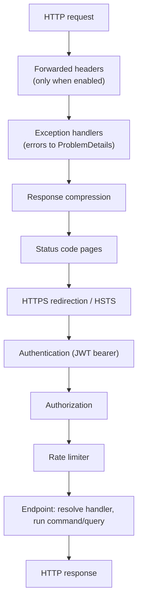
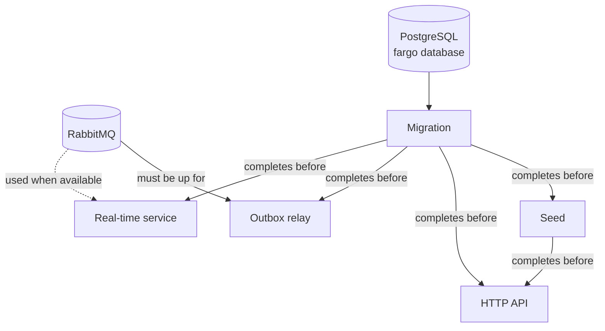

# Server Architecture

Fargo's server follows a clean, layered architecture. This page explains the
layers and the rule that governs their dependencies, how each host is composed,
the CQRS pattern used by the application layer, the lifecycle of a request, and
how the services start.

## Layers and the dependency rule

There are three layers plus the hosts that run them. **Dependencies point
inward**: each layer may depend only on the layers beneath it, never on the
layers above. The domain at the center has no dependencies at all.

| Layer | Project | Responsibility | Depends on |
| --- | --- | --- | --- |
| Domain | `Fargo.Core` | Entities, value objects, enums, and the rules that are always true regardless of how data is stored or exposed. Defines ports such as the repository interfaces and `IActorAuthorizationProvider`. | nothing |
| Application | `Fargo.Application` | Use cases as CQRS commands and queries with handlers, DTOs, query repository interfaces, and integration event contracts. | Core |
| Infrastructure | `Fargo.Infrastructure` | Concrete implementations: EF Core persistence, repositories, security, the outbox, RabbitMQ messaging, and the authorization cache. | Application, Core |
| Hosts | `Fargo.ServiceHttp`, `Fargo.ServiceRealtime`, `Fargo.ServiceOutbox`, `Fargo.ServiceMigration`, `Fargo.ServiceSeed` | Each host is a composition root that wires the layers together for one job. | Application, Infrastructure, ServiceDefaults |

Because the inner layers define the interfaces and the infrastructure layer
implements them, the domain and use cases never depend on Entity Framework,
PostgreSQL, RabbitMQ, a cache, or ASP.NET Core.

## Composition

Each layer exposes a single DI extension: `AddFargoServiceDefaults`,
`AddFargoApplication` and `AddFargoInfrastructure`. Every host calls them, then
adds only what its job needs. `AddFargoInfrastructure` registers everything
lazily, so a host only pays for the services it actually resolves.

| Host | Adds on top of the layers |
| --- | --- |
| `Fargo.ServiceHttp` | API versioning, JSON converters, JWT authentication, exception handlers, rate limiting, forwarded headers, the endpoints and the database health check. |
| `Fargo.ServiceRealtime` | JWT authentication (with the token accepted in the query string under `/hubs`), SignalR, the RabbitMQ consumer and the connection registry. See [Real-time Updates](realtime.md). |
| `Fargo.ServiceOutbox` | The RabbitMQ client and the relay loop. See [Integration Events](integration-events.md). |
| `Fargo.ServiceMigration`, `Fargo.ServiceSeed` | Their one-time startup job. See [Persistence](persistence.md). |

## CQRS

The application layer separates writes from reads:

- **Commands** change state. They implement `ICommand` or `ICommand<TResult>`
  and are handled by `ICommandHandler<TCommand>` / `ICommandHandler<TCommand, TResult>`.
- **Queries** read state. They implement `IQuery<TResult>` and are handled by
  `IQueryHandler<TQuery, TResult>`.

Handlers are registered explicitly in `AddFargoApplication` (grouped per
resource, for example `AddFargoArticleApplication`). HTTP endpoints stay thin:
each endpoint resolves the relevant handler, builds the command or query from
the request, and returns the result.

Every command handler is wrapped in decorators, from the outside in:

1. **Logging**: logs the operation, its actor and its duration.
2. **Unit of work**: saves all changes when the handler succeeds. A command that
   implements `ITransactionalCommand` instead runs inside an explicit
   transaction (begin, handler, save, commit), for handlers that must read and
   write consistently.
3. **Audit**: records an audit log for the command, unless the command
   implements `INonAuditedCommand` (for example the outbox commands).

Queries get only the logging decorator. Reads go through dedicated query
repositories that project straight to DTOs.

## Request lifecycle

The HTTP API's middleware pipeline, in order:

Within an endpoint, a typical write flows:

1. The endpoint builds a command and calls its handler.
2. The handler resolves the current actor (see
   [Security](security.md#how-the-principal-is-read-and-cached)) and checks
   permission and partition access, throwing an exception if denied.
3. The handler loads and mutates domain entities through write repositories.
4. The audit decorator records an audit log for the command.
5. The unit of work saves everything in one transaction. In the same save, the
   outbox stores an integration event for each changed article, and the
   authorization stamp is renewed if permissions or partition access changed.

Exceptions raised anywhere in that flow are translated to
[RFC 7807 problem details](cross-cutting.md#error-handling).

## Startup and orchestration

For local development, `Fargo.AppHost` (.NET Aspire) starts PostgreSQL, RabbitMQ
and the hosts in dependency order:

The outbox relay waits for RabbitMQ. The real-time service doesn't: it serves
connections while the broker is down and its consumer retries until it is up.

See [Operations](operations.md) for how to run this and
[Persistence](persistence.md) for what migration and seeding do.
