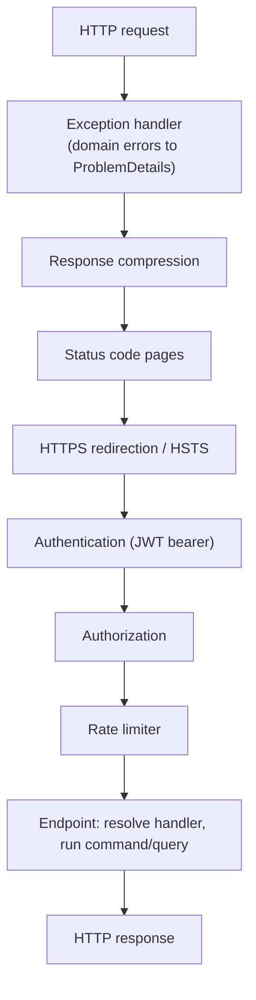
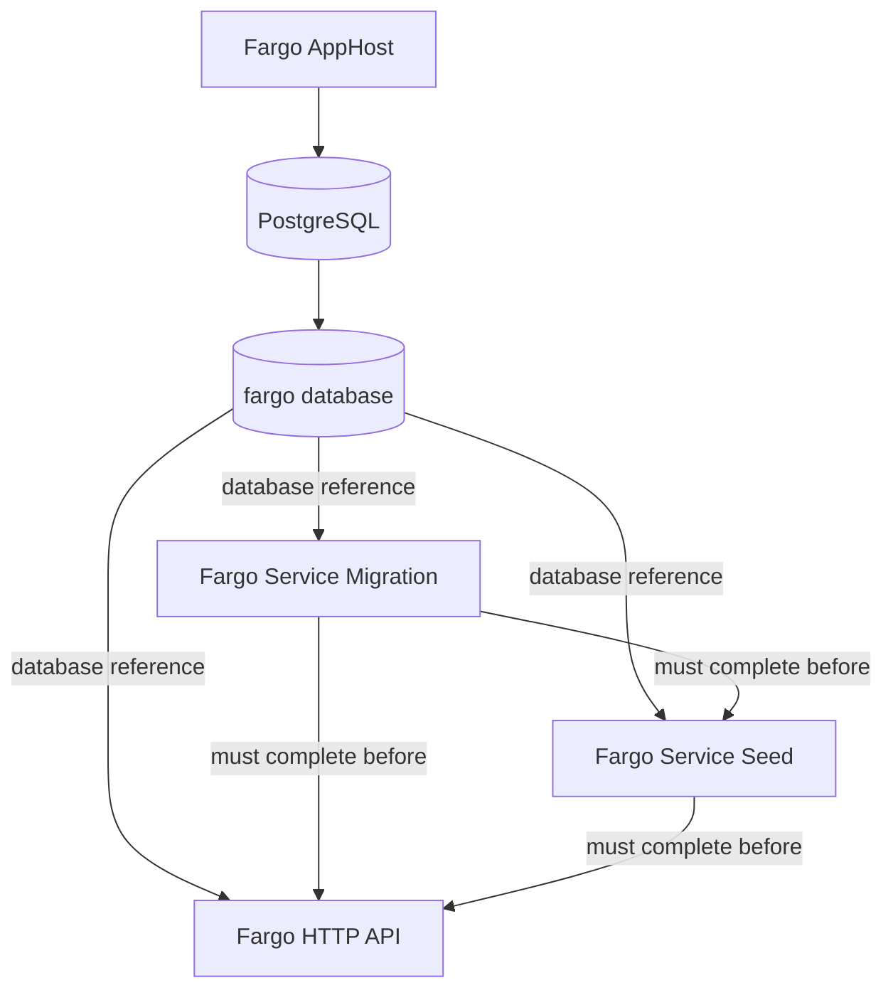

# Server Architecture

Fargo's server follows a clean, layered architecture. This page explains the
layers and the rule that governs their dependencies, how the application is
composed at startup, the CQRS pattern used by the application layer, and the
lifecycle of a request.

## Layers and the dependency rule

There are four layers. **Dependencies point inward**: each layer may depend only
on the layers beneath it, never on the layers above. The domain at the center
has no dependencies at all.

| Layer | Project | Responsibility | Depends on |
| --- | --- | --- | --- |
| Domain | `Fargo.Core` | Entities, value objects, enums, and the rules that are always true regardless of how data is stored or exposed. | nothing |
| Application | `Fargo.Application` | Use cases as CQRS commands and queries with handlers, DTOs, and the repository interfaces the handlers depend on. | Core |
| Infrastructure | `Fargo.Infrastructure` | Concrete implementations: EF Core persistence, repositories, and security services. | Application, Core |
| Host | `Fargo.ServiceHttp` | The HTTP surface and the composition root that wires everything together. | Application, Infrastructure, ServiceDefaults |

Because the application layer defines its repository interfaces and the
infrastructure layer implements them, the domain and use cases never depend on
Entity Framework, PostgreSQL, or ASP.NET Core.

## Composition root

`Fargo.ServiceHttp/Program.cs` is the composition root. It registers services in
this order and then builds the request pipeline:

```csharp
builder.AddFargoServiceDefaults();          // OpenTelemetry, health, resilience
builder.Services.AddResponseCompression();
builder.Services.AddFargoRouteConstraints();
builder.Services.AddFargoOpenApi();
builder.Services.ConfigureHttpJsonOptions(/* Fargo JSON converters */);
builder.Services.AddFargoApplication();      // CQRS handlers
builder.Services.AddFargoInfrastructure(...);// DbContext, repositories, security
builder.Services.AddAuthentication(JwtBearerDefaults.AuthenticationScheme)
                .AddJwtBearer();
builder.Services.AddAuthorization();
builder.Services.AddFargoExceptionHandler(); // maps domain exceptions to ProblemDetails
builder.Services.AddProblemDetails();
builder.Services.AddFargoRateLimiter();
builder.Services.AddHealthChecks().AddDbContextCheck<FargoDbContext>();
```

Each layer exposes a single DI extension — `AddFargoApplication`,
`AddFargoInfrastructure`, `AddFargoServiceDefaults` — so the host composes the
system from a few well-named calls.

## CQRS

The application layer separates writes from reads:

- **Commands** change state. They implement `ICommand` or `ICommand<TResult>`
  and are handled by `ICommandHandler<TCommand>` / `ICommandHandler<TCommand, TResult>`.
- **Queries** read state. They implement `IQuery<TResult>` and are handled by
  `IQueryHandler<TQuery, TResult>`.

Handlers are registered explicitly in `AddFargoApplication` (grouped per
resource, e.g. `AddFargoArticleApplication`). HTTP endpoints stay thin: each
endpoint resolves the relevant handler, builds the command or query from the
request, and returns the result.

Handlers resolve the current [actor](security.md) through `ICurrentActor`,
enforce permissions and partition access, mutate domain entities, and commit
through `IUnitOfWork`. Reads go through dedicated query repositories that project
straight to DTOs.

## Request lifecycle

The middleware pipeline, in order:



Within an endpoint, a typical write flows:

1. The endpoint builds a command and calls its handler.
2. The handler resolves the current actor and checks permission and partition
   access, throwing a domain exception if denied.
3. The handler loads and mutates domain entities through write repositories.
4. An audit log is created for the change.
5. `IUnitOfWork` commits the transaction.

Domain exceptions raised anywhere in that flow are translated to
[RFC 7807 problem details](cross-cutting.md#error-handling) by the exception
handler.

## Startup and orchestration

For local development, `Fargo.AppHost` (.NET Aspire) starts the database and the
service projects in dependency order: migrations first, then seeding, then the
HTTP API.



See [Operations](operations.md) for how to run this and
[Persistence](persistence.md) for what migration and seeding do.
