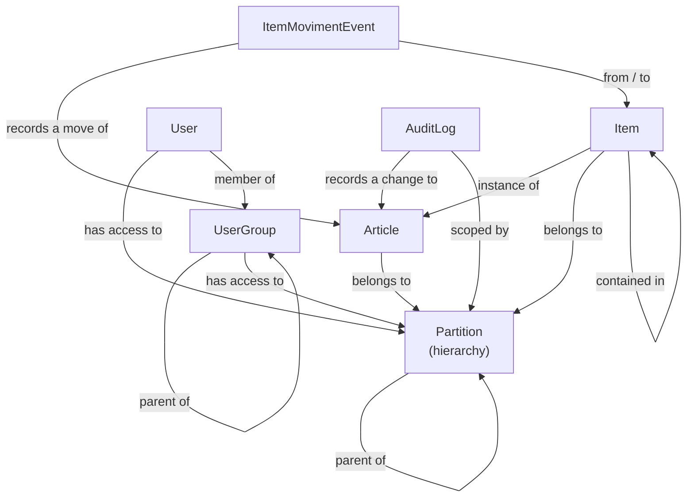

# Domain Model

The domain lives in `Fargo.Core` and has no dependencies on persistence or the
web host. This page describes the core concepts, how they relate, the
enumerations that classify them, and the rules the domain enforces.

For type-level detail, browse the generated
[.NET API Reference](~/api/index.md) under the `Fargo.Core` namespaces.

## Entities

Every domain entity has a `Guid` identity (`IEntity`) and reports its kind
(`IEntityTyped.GetEntityType()`).

| Concept | Description |
| --- | --- |
| **Article** | A product definition in the catalog. Has a type, a tracking mode (entity or event), optional barcodes, dimensions, mass, color, and shelf life. |
| **Item** | A physical instance of an **entity-tracked** article. May live inside a container item, and records its movement history. |
| **ItemEvent** | The base record of a change recorded against an **event-tracked** article: which article, the event kind, and when it occurred. |
| **ItemMovimentEvent** | A movement event: a positive quantity of an event-tracked article moved between containers (or into/out of no container). The source of event-based inventory. |
| **Partition** | A node in the access hierarchy. Scopes which actors can see which entities. |
| **User** | An account that authenticates and acts. Has partition access, group memberships, and permissions. |
| **UserGroup** | A collection of users that share permissions and partition access. Groups can be nested. |
| **AuditLog** | An immutable record of a change to an entity. |
| **Actor** | The authenticated identity performing an operation, with its resolved permissions and partition access. |

## Relationships

## Partitions and access inheritance

Partitions form a hierarchy with a single **global partition** at the root
(identified by a well-known GUID; its `ParentPartitionGuid` is `null`). Every
other partition has a parent.

Access inheritance flows **from parent to child, never from child to parent**:

- A user with access to a partition can also access entities in that
  partition's descendants.
- A user with access only to a child partition cannot access the parent or
  sibling branches.
- The global partition sits above everything; access to it is reserved for
  highly privileged users.

The domain guards the hierarchy's local invariants — the global partition cannot
have a parent, and a partition cannot be its own parent. Validating the overall
hierarchy (for example, detecting cycles) is done in the application layer before
a parent is assigned.

An actor's access check is simple: a resource is accessible if it has no
partitions, or if any of its partitions is one the actor can access.

## Value objects

Validated value objects wrap primitive data so invalid values cannot exist in
the domain: `Name`, `Description`, `Nameid`, `FirstName`, `LastName`. Physical
quantities use [UnitsNet](https://github.com/angularsen/UnitsNet) types such as
`Mass` and `Length`.

## Audit logs

An audit log is created for every create, update, and delete. It captures the
acting actor, the affected entity and its type, the
[`AuditLogType`](#auditlogtype), the time, and a metadata bag describing the
change. Its partition scope is derived from the audited entity (for partition
actions, from the affected partition's parent), so audit logs follow the same
access rules as the entities they describe. Metadata is an open set of typed
values (string, number, boolean, null, object, array).

See [Persistence](persistence.md#audit-logs) for how audit logs and their
metadata are stored.
