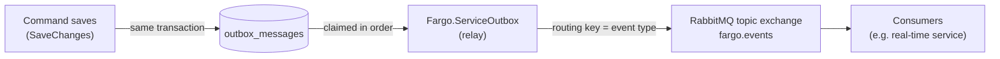

# Integration Events

When an article changes, Fargo publishes an **integration event** to a RabbitMQ
topic exchange, so other systems can react without polling the API. The
[real-time service](realtime.md) is one such consumer. This page explains how
events are produced, how they reach the broker, and the contract consumers can
rely on.

Today only **articles** produce events: `article.created`, `article.edited` and
`article.deleted`.

## From a change to the broker



1. **The outbox.** A save-changes interceptor (`OutboxSaveChangesInterceptor`)
   adds a row to `outbox_messages` for every article event of the save, in the
   same transaction as the change. A change that rolls back produces no event,
   and a committed change can't lose its event.
2. **The relay.** `Fargo.ServiceOutbox` claims the oldest unpublished rows with
   `FOR UPDATE SKIP LOCKED`, so several relays never publish the same row. It
   publishes them in order and marks them processed. Publishing stops at the
   first failure, and that row and the ones after it are retried later, so
   order is preserved. The claim and the marks run in one transaction, owned by
   the unit of work because the publish command is transactional. When the
   relay stops, what was already published is still committed, so it isn't
   sent again.
3. **The broker.** Each event is published to the durable topic exchange
   `fargo.events`, with its event type as the routing key, as a persistent
   message. A publish only counts once RabbitMQ confirms it.

## What produces an event

| Change in the save | Event |
| --- | --- |
| An article is added | `article.created` |
| An article is deleted | `article.deleted` |
| An article, or one of its parts, is modified, added or deleted | `article.edited` |

An article's parts are its barcode, dimension, variation, pack, kit components,
container, allowed container articles and partitions. Each article produces at
most one event per save: a created or deleted article reports only that, even
when its parts changed with it.

Changes made outside the EF Core change tracker (raw SQL, `ExecuteUpdate`,
`ExecuteDelete`) produce no event.

## The message

Article events have schema version **2**:

```json
{
  "eventId": "6f1c2b3a-0000-7000-8000-000000000001",
  "eventType": "article.edited",
  "occurredAt": "2026-11-06T14:03:22+00:00",
  "articleGuid": "a3e9d1c2-0000-4000-8000-000000000002",
  "partitionGuids": ["10000000-0000-4000-8000-000000000001"]
}
```

| Field | Meaning |
| --- | --- |
| `eventId` | Unique per event. Use it to discard duplicates. |
| `eventType` | The routing key: `article.created`, `article.edited` or `article.deleted`. |
| `occurredAt` | When the change was saved, in UTC. |
| `articleGuid` | The article that changed. Read its current state through the API; a deleted article has none. |
| `partitionGuids` | Every partition the article belonged to **before or after** the change. |

The message identifies what changed, not its new state. `partitionGuids` lets a
consumer decide who may learn about the change without reading the database: an
actor may see the event only when it can access at least one of these
partitions. Because it includes the partitions from before the change, the
actors that just lost access are told too.

The AMQP message properties carry the envelope: `message-id` is the event id,
`type` is the event type, the content type is `application/json`, and the
`schema-version` header holds the version. Version 2 added `partitionGuids`;
consumers must drop messages of a version they don't know instead of guessing.

## Delivery guarantees

- **At least once.** If the relay stops after the broker accepted a message but
  before marking it processed, the message is published again. Deduplicate on
  `eventId`.
- **In order** as stored, for a single relay. Consumers that use several
  channels or reorder work lose that order.
- **No events for a disconnected consumer queue.** A topic exchange drops
  messages with no bound queue. Consumers that must not miss events need a
  durable queue; the real-time service deliberately uses a temporary queue per
  instance.

## Consuming events

Bind a queue to `fargo.events` with the routing keys you need, for example
`article.*` for every article event. The real-time service does this with
`RabbitMqArticleEventConsumer` (`Fargo.Infrastructure/Messaging`), which hands
each message to an `IArticleEventHandler`. A host that wants to react to events
can reuse it by registering its own handler with `AddFargoArticleEventConsumer`.

## Configuration

| Section | Key | Default | Meaning |
| --- | --- | --- | --- |
| `RabbitMqEvents` | `ExchangeName` | `fargo.events` | The topic exchange, used by the publisher and the consumer. |
| `RabbitMqEvents` | `PublishTimeout` | `00:00:10` | How long a publish waits for the broker's confirm. |
| `Outbox` | `PollInterval` | `00:00:01` | The relay's wait when there is nothing to publish. |
| `Outbox` | `BatchSize` | `100` | Rows claimed per batch. A full batch is followed by the next one at once. |
| `Outbox` | `MaxRetryDelay` | `00:01:00` | The longest wait after failures; the wait doubles from `PollInterval`. |
| `Outbox` | `Retention` | `7.00:00:00` | How long published rows are kept before they are purged. |
| `Outbox` | `PurgeInterval` | `01:00:00` | How often the purge runs. |

The broker connection string is named `fargo-rabbitmq`. Under Aspire it is
supplied automatically.
