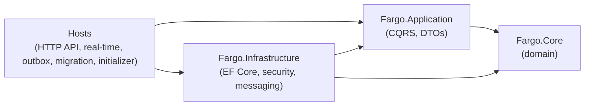

# Server Overview

The Fargo server is a .NET solution that implements the inventory domain and
exposes it over HTTP, with changes pushed live to connected clients. It follows
a clean, layered architecture and is orchestrated for local development with
[.NET Aspire](https://learn.microsoft.com/dotnet/aspire/).

This section documents how the server is built. For the HTTP endpoints see the
[Web API Reference](~/web-api/reference/fargo.swagger.json); for type-level
detail see the generated [.NET API Reference](~/api/index.md).

## Solution layout

Everything lives under `src/`, with tests under `tests/`.

**Layers:**

| Project | Role |
| --- | --- |
| `Fargo.Core` | The domain layer: entities, value objects, enums, and domain rules. No external dependencies. |
| `Fargo.Application` | The application layer: CQRS commands/queries and their handlers, DTOs, repository interfaces, and integration event contracts. Depends only on `Fargo.Core`. |
| `Fargo.Infrastructure` | The infrastructure layer: EF Core persistence and migrations, repositories, security, the outbox, RabbitMQ messaging, and the authorization cache. Depends on `Fargo.Application` and `Fargo.Core`. |

**Hosts** (the processes that run):

| Project | Role |
| --- | --- |
| `Fargo.Api` | The HTTP API: minimal-API endpoints, authentication, rate limiting, OpenAPI, and error handling. |
| `Fargo.Realtime` | The real-time service: a SignalR hub that pushes changes to connected clients. |
| `Fargo.OutboxRelay` | A background worker that publishes stored integration events to RabbitMQ. |
| `Fargo.Migrator` | A startup worker that applies pending database migrations, then exits. |
| `Fargo.Initializer` | A startup worker that initializes the system state (global partition, administrators group, default admin), then exits. |
| `Fargo.ServiceDefaults` | Shared host defaults: OpenTelemetry, health checks, resilience, and service discovery. |
| `Fargo.AppHost` | The .NET Aspire orchestrator that runs PostgreSQL, RabbitMQ, and the hosts together for local development. |

**Clients** (libraries and tools that talk to the server):

| Project | Role |
| --- | --- |
| `Fargo.Client` | The HTTP client, generated with Kiota from the OpenAPI document, with token storage and refresh. |
| `Fargo.Client.Realtime` | The client for the real-time hub; it makes no API requests. |
| `Fargo.Realtime.Contracts` | The wire contract of the real-time hub, shared by the server and the client. |
| `Fargo.Cli` | The `fargo` command-line client. |
| `Fargo.Mcp` | The Model Context Protocol server for AI agents. |

## Technology stack

- **.NET 10** across all projects.
- **ASP.NET Core minimal APIs** for the HTTP surface, and **SignalR** for
  real-time push.
- **Entity Framework Core 10** with **Npgsql** over **PostgreSQL**, using the
  snake_case naming convention.
- **RabbitMQ** for integration events, fed by a transactional outbox.
- **JWT bearer authentication** with refresh tokens.
- **.NET `HybridCache`** for the actor authorization cache.
- **.NET Aspire** for local orchestration, and **OpenTelemetry** for logs,
  metrics, and traces.
- **[UnitsNet](https://github.com/angularsen/UnitsNet)** for physical quantities
  (mass, length).

## How the layers relate

Dependencies point inward: outer layers depend on inner layers, never the
reverse. The domain (`Fargo.Core`) has no dependencies, and each host wires the
layers together.

## Where to go next

- [Architecture](architecture.md): layers, the dependency rule, CQRS, the request
  lifecycle, and startup.
- [Domain Model](domain-model.md): the core concepts and their rules.
- [Persistence](persistence.md): EF Core, migrations, and system initialization.
- [Security](security.md): authentication, permissions, partition scoping, and
  the authorization cache.
- [Integration Events](integration-events.md): the outbox and the events
  published to RabbitMQ.
- [Real-time Updates](realtime.md): pushing changes to connected clients.
- [Cross-Cutting Concerns](cross-cutting.md): errors, rate limiting, telemetry.
- [Operations](operations.md): running and configuring the server.
