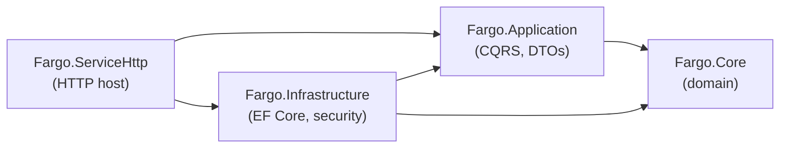

# Server Overview

The Fargo server is a .NET solution that implements the inventory domain and
exposes it over HTTP. It follows a clean, layered architecture and is
orchestrated for local development with [.NET Aspire](https://learn.microsoft.com/dotnet/aspire/).

This section documents how the server is built. For the HTTP endpoints see the
[Web API Reference](~/docs/web-api/reference/fargo.swagger.json); for type-level
detail see the generated [.NET API Reference](~/api/index.md).

## Solution layout

The server lives under `src/server/` and is composed of eight projects:

| Project | Role |
| --- | --- |
| `Fargo.Core` | The domain layer: entities, value objects, enums, and domain rules. No external dependencies. |
| `Fargo.Application` | The application layer: CQRS commands/queries and their handlers, DTOs, and repository interfaces. Depends only on `Fargo.Core`. |
| `Fargo.Infrastructure` | The infrastructure layer: Entity Framework Core persistence, repositories, migrations, and security implementations. Depends on `Fargo.Application` and `Fargo.Core`. |
| `Fargo.ServiceHttp` | The HTTP host: minimal-API endpoints, authentication, rate limiting, OpenAPI, and error handling. The composition root. |
| `Fargo.ServiceDefaults` | Shared host defaults: OpenTelemetry, health checks, resilience, and service discovery. Referenced by the service hosts. |
| `Fargo.ServiceMigration` | A startup worker that applies pending database migrations. |
| `Fargo.ServiceSeed` | A startup worker that seeds the initial system state (global partition, administrators group, default admin). |
| `Fargo.AppHost` | The .NET Aspire orchestrator that runs PostgreSQL and the service projects together for local development. |

## Technology stack

- **.NET 10** across all projects.
- **ASP.NET Core minimal APIs** for the HTTP surface.
- **Entity Framework Core 10** with **Npgsql** over **PostgreSQL**, using the
  snake_case naming convention.
- **JWT bearer authentication** with refresh tokens.
- **.NET Aspire** for local orchestration, and **OpenTelemetry** for logs,
  metrics, and traces.
- **[UnitsNet](https://github.com/angularsen/UnitsNet)** for physical quantities
  (mass, length).

## How the layers relate

Dependencies point inward: outer layers depend on inner layers, never the
reverse. The domain (`Fargo.Core`) has no dependencies, and the HTTP host wires
everything together.

## Where to go next

- [Architecture](architecture.md) — layers, the dependency rule, CQRS, and the
  request lifecycle.
- [Domain Model](domain-model.md) — the core concepts and their rules.
- [Persistence](persistence.md) — EF Core, migrations, and seeding.
- [Security](security.md) — authentication, permissions, and partition scoping.
- [Cross-Cutting Concerns](cross-cutting.md) — errors, rate limiting, telemetry.
- [Operations](operations.md) — running and configuring the server.
